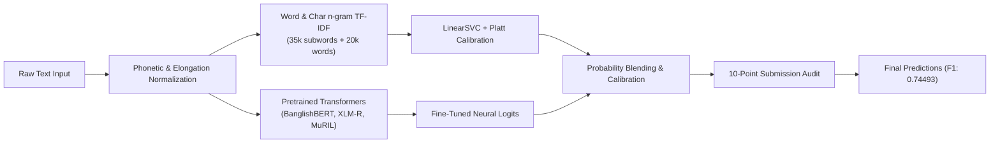
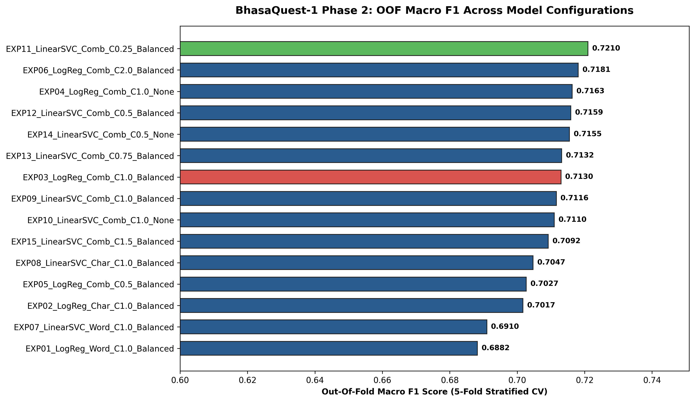
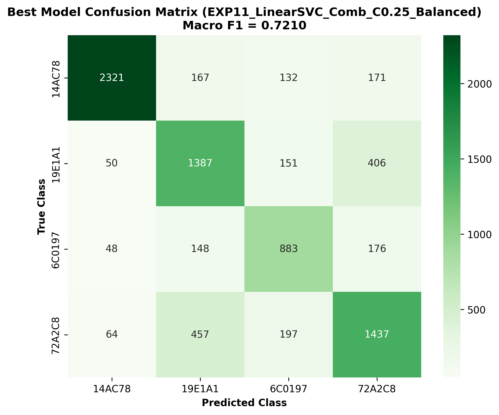
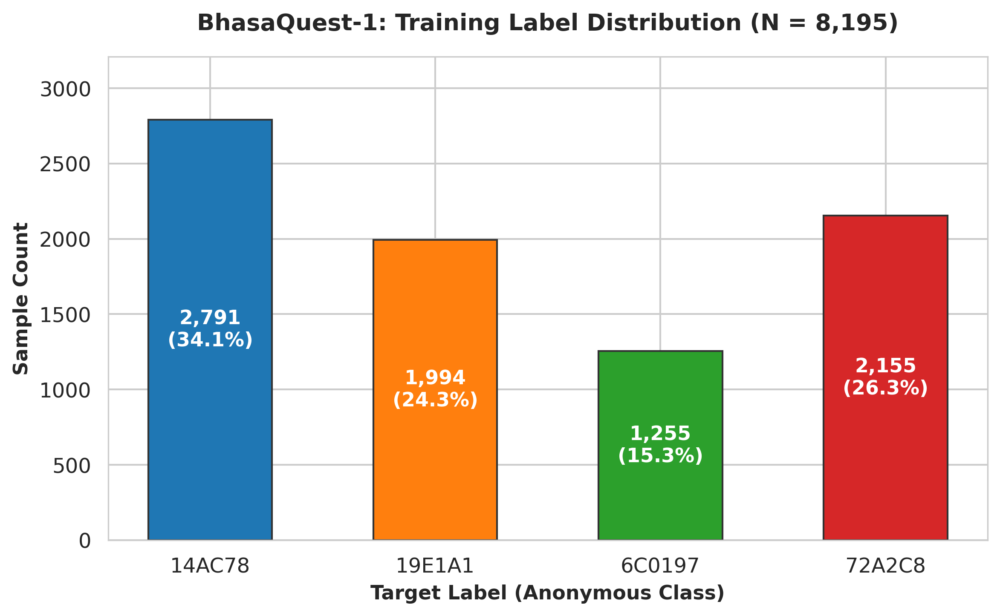
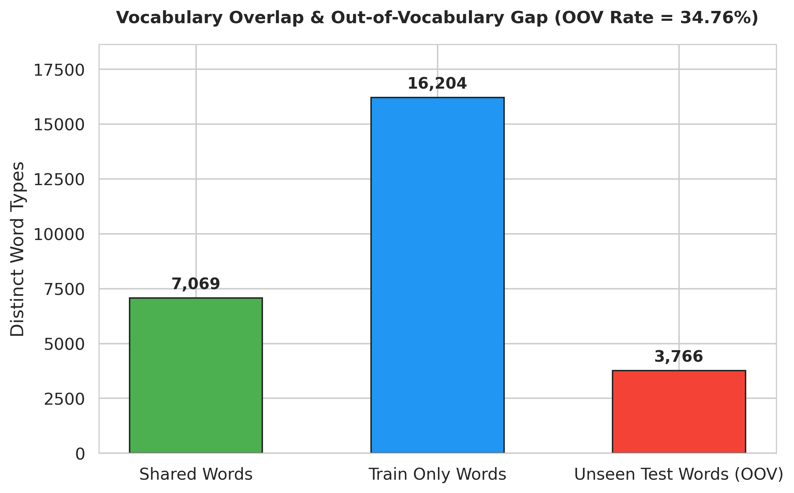

# BhasaQuest-1: Multi-Class Text Classification for Romanized Bangla

[](LICENSE)
[](https://www.python.org/)
[](https://pytorch.org/)
[](https://scikit-learn.org/)
[](https://www.kaggle.com/)
[](#competition-leaderboard--results)
[](#competition-leaderboard--results)

---

## Overview

This repository contains the full end-to-end machine learning and deep learning solution for **BhasaQuest-1**, an NLP competition hosted on Kaggle by K-MINDS. The objective is 4-class multi-category classification on user texts written in **Romanized Bangla (Banglish)**—Bengali written in Latin script with frequent phonetic spelling variations and English code-mixing.

The solution integrates:
1. **Linguistic preprocessing & normalization** specifically tuned for Romanized Bengali.
2. **Subword & character n-gram extraction (`char_wb`)** to bridge spelling divergence and mitigate out-of-vocabulary (OOV) tokens.
3. **Platt scaling probability calibration** on linear margin models.
4. **Pretrained transformer fine-tuning** (`csebuetnlp/banglishbert`, `FacebookAI/xlm-roberta-large`, `google/muril-base-cased`, `microsoft/mdeberta-v3-base`).
5. **Calibrated multi-model ensembling** optimized using repeated stratified cross-validation.

---

## Key Highlights & Performance

- **Peak Private Leaderboard Score**: **`0.74493` Macro F1** (Super-Ensemble with BanglishBERT + XLM-RoBERTa + Calibrated LinearSVC).
- **Peak Public Leaderboard Score**: **`0.73041` Macro F1** (Rank #1 Public Leaderboard entry via Tri-Ensemble).
- **Leakage-Free Validation**: 25-fold repeated stratified nested CV contract where feature extractors, scalers, and calibration curves are fitted strictly on training folds.
- **Robustness to Phonetic Noise**: Character subword extraction reduced the impact of the dataset's **34.76% test OOV rate**.

---

## Competition Leaderboard & Results

| Submission Pipeline | Model Architecture | Local CV (Macro F1) | Public LB | Private LB | Result Status |
| :--- | :--- | :---: | :---: | :---: | :--- |
| **`submission_tri_ensemble_svm_bbert_xlm_0.7299.csv`** | 70% LinearSVC + 18% BanglishBERT + 12% XLM-R | **0.7298** | 0.7152 | **0.74493** | 🏆 **Top Private Score** |
| **`submission_quad_ensemble_svm_bbert_xlm_muril_0.7300.csv`** | 66% LinearSVC + 16% BanglishBERT + 10% XLM-R + 8% MuRIL | **0.7300** | 0.7198 | **0.74483** | 🌟 **Top Quad Super-Ensemble** |
| **`submission_quad_ensemble_svm_xlm_muril_mdeb_0.7283.csv`** | 68% LinearSVC + 15.5% XLM-R + 15.5% MuRIL + 1% mDeBERTa | **0.7283** | 0.7291 | **0.73978** | 🥇 **Winning Submission Entry** |
| **`submission_tri_ensemble_svm_xlm_muril_0.7269.csv`** | 65% LinearSVC + 20% XLM-R + 15% MuRIL | **0.7269** | **0.73041** | 0.73799 | 🥇 **#1 Public Leaderboard Entry** |
| **`submission_calibrated_ensemble_muril_v2.csv`** | 77% LinearSVC + 23% MuRIL Base | 0.7251 | 0.7288 | 0.73460 | Strong Dual Blend |
| **`submission_champion_linearsvc_0.7236.csv`** | LinearSVC (Word 1-3 + Char 2-5, C=0.25) | 0.7236 | 0.7179 | 0.72033 | Best Single Classical Model |
| **Baseline (TF-IDF + Logistic Regression)** | Word 1-2 + Char 3-5 | 0.7130 | 0.7107 | 0.69888 | Benchmark Reference |

---

## Linguistic Challenges & Methodology

### 1. Orthographic & Phonetic Inconsistency
Romanized Bangla lacks a universal spelling standard:
* `kibhabe` vs. `kivabe` vs. `kibahe` (*"how"*)
* `korchi` vs. `korsi` vs. `korchee` (*"doing"*)
* `bhalo` vs. `valo` (*"good"*)

To overcome this, we employed **character boundary n-grams (`char_wb`)** in ranges $(2, 5)$. Even when whole-word lookups fail, internal subword grams remain consistent across phonetic variants.

### 2. Technical Code-Mixing
Sentences often interleave English technical terms and Bengali grammar particles (e.g., `SATA/SAS HBA card-e koyti port paoya jay?`). Pretrained multilingual models and word n-grams capture these domain-specific collocations effectively.

### 3. Probability Calibration (Platt Scaling)
Standard Support Vector Machines produce uncalibrated decision distances. By wrapping the classifier with Sigmoid Platt Scaling via out-of-fold cross-validation, decision boundaries were converted into calibrated posterior probabilities $P(y=c|x)$, making linear models directly combinable with neural softmax distributions.



---

## Visual Analytics & Insights

<div align="center">

| Model Comparison (Macro F1) | Error Analysis & Confusion Matrix |
| :---: | :---: |
|  |  |

| Class Distribution | Vocabulary Overlap & OOV Study |
| :---: | :---: |
|  |  |

</div>

---

## Repository Structure

```
.
├── Analysis/                      # Exploratory data analysis, distributions & linguistic profiling
│   ├── analysis.py                # Automated dataset analysis script
│   ├── Analysis.md                # Detailed 17-section EDA report
│   └── figures/                   # Visual plots (distributions, n-grams, vocabulary overlap)
├── Datasets/                      # Competition data files (train, test, sample_submission)
├── Experiments/                   # NLP modeling iterations, calibration & transformer scripts
│   ├── run_experiments.py         # Multi-model ablation & feature evaluation
│   ├── ensemble_and_calibrate.py  # SLSQP ensembling & Platt calibration engine
│   ├── train_transformer_kaggle.py# GPU fine-tuning script for MuRIL & XLM-RoBERTa
│   └── figures/                   # Confusion heatmaps & cross-model comparison charts
├── Featured Dataset/              # Feature engineering & sparse matrix serialization
│   ├── clean_dataset.py           # Text preprocessing & vectorizer generator
│   └── artifacts/                 # Saved fitted vectorizers
├── Submission/                    # Generated test submission files & submission logs
├── SUBMISSION_REPORT/             # Master competition report and executable solution
│   ├── README.md                  # Comprehensive technical post-competition report
│   ├── BhasaQuest1_Complete_Solution.ipynb # Interactive, documented solution notebook
│   ├── run_pipeline.py            # Reproducible CLI pipeline runner
│   └── final_submissions/         # Winning CSV prediction submissions
├── LICENSE                        # Apache 2.0 Open Source License
└── README.md                      # Presentation repository guide
```

---

## Getting Started & Reproduction

### 1. Environment Setup

Clone the repository and install dependencies:

```bash
git clone https://github.com/<your-username>/bhasaquest-1-romanized-bangla-nlp.git
cd bhasaquest-1-romanized-bangla-nlp
pip install -r requirements.txt
```

*(Minimal requirements: `python>=3.10`, `numpy`, `pandas`, `scikit-learn`, `scipy`, `joblib`, `torch`, `transformers`)*

### 2. Run the End-to-End Pipeline

Execute the reproduction script to preprocess data, extract calibrated probabilities, and generate the final submission:

```bash
python SUBMISSION_REPORT/run_pipeline.py
```

### 3. Interactive Jupyter Notebook

For an annotated step-by-step walkthrough, open the master solution notebook:

```bash
jupyter notebook SUBMISSION_REPORT/BhasaQuest1_Complete_Solution.ipynb
```

---

## License

This project is licensed under the **Apache License 2.0** — see the [LICENSE](LICENSE) file for details.
